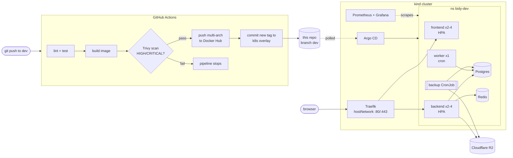

# Bidy on Kubernetes: GitOps on a local kind cluster

An online auction platform (Node/TypeScript API + cron worker, Next.js frontend, Postgres, Redis,
Cloudflare R2) shipped to a 3-node **kind** cluster with a full CI/CD and GitOps pipeline:
GitHub Actions builds and scans the images, **Argo CD** pulls the desired state from this repo.

| | |
|---|---|
| CI | GitHub Actions: lint, test, Docker build, **Trivy** scan (fails on HIGH/CRITICAL), multi-arch push to Docker Hub |
| CD | **Argo CD** app-of-apps, automated sync with prune and self-heal; CI commits the new image tag, Argo rolls it out |
| Cluster | kind (1 control-plane + 2 workers), **Cilium** CNI, **Traefik** ingress |
| Secrets | **Sealed Secrets**: encrypted values live in git, only the cluster can decrypt them |
| Resilience | HPA, PodDisruptionBudgets, probes, daily Postgres backup to R2 with a tested restore |
| Security | default-deny **NetworkPolicy**, non-root pods, read-only root filesystem, dropped capabilities, Trivy gate |
| Observability | **kube-prometheus-stack** (Prometheus, Grafana, alert rules for the app and the backups) |

## Features

**Delivery (CI/CD and GitOps)**
- Separate GitHub Actions pipelines for backend and frontend, triggered only by changes in their folder.
- Lint, tests (frontend with coverage artifact), multi-arch Docker build with layer cache.
- Trivy scan on every build: JSON report as an artifact, pipeline stops on HIGH/CRITICAL findings.
- Images pushed to Docker Hub as `dev-<sha>`; the pipeline commits the new tag to the repo.
- Argo CD app-of-apps: one `root` application creates every other application from git, with automated sync, prune and self-heal.
- Database migrations and seed run as an Argo CD sync hook before each rollout.

**Platform**
- 3-node kind cluster with per-node CPU/memory caps, rebuilt with one command (`bootstrap.sh`).
- Cilium as CNI (enforces NetworkPolicy), Traefik as ingress, metrics-server for HPA.
- Sealed Secrets: secrets are committed encrypted, decrypted only inside the cluster.

**Application runtime**
- Frontend and backend scale 2 to 4 replicas on CPU (HPA); PodDisruptionBudgets keep at least one running during drains and rollouts.
- Dedicated single-replica worker owns the cron jobs, so they never run twice when the API scales.
- Postgres and Redis as StatefulSets with persistent volumes; liveness and readiness probes everywhere.
- Resource requests and limits on every workload.

**Security**
- Default-deny NetworkPolicy with explicit allow rules (Traefik to app, app to Postgres/Redis/DNS/HTTPS, backup to Postgres/R2).
- All pods run as non-root with a read-only root filesystem, no privilege escalation, all capabilities dropped, seccomp `RuntimeDefault`.
- Vulnerability gate in CI and trimmed runtime images (no npm/corepack).

**Reliability and operations**
- Daily Postgres backup to Cloudflare R2, 7-day retention, restore procedure tested end to end.
- Prometheus and Grafana with ready-made Kubernetes dashboards, plus alerts for crash-looping pods, unready pods, unavailable deployments, HPA at max, and failed or missing backups.

## Architecture



**Delivery flow:** a push to `dev` runs the pipeline for the changed app. After the image passes the
Trivy gate and is pushed, the workflow edits the image tag in
[`k8s/apps/bidy/overlays/dev/kustomization.yaml`](k8s/apps/bidy/overlays/dev/kustomization.yaml)
and commits it back. Argo CD sees that commit, runs the migration hook, and rolls the
Deployments. Git is the only source of truth; nothing is applied from a laptop after bootstrap.

## Repository layout

```
.github/workflows/   cicd-dev-be.yml, cicd-dev-fe.yml (path-filtered, environment: dev)
bidy-be/  bidy-fe/   application code and Dockerfiles
k8s/
  cluster/           kind config, bootstrap.sh, node limits, sealed-key export
  platform/          Helm values: cilium, traefik, sealed-secrets, metrics-server, monitoring
  apps/bidy/         Kustomize base + overlays/dev (manifests for the app)
  argocd/            root.yaml and applications/ (one Argo CD Application per component)
  docs/              runbooks (restore-postgres.md)
```

## Run it

Needs: Docker (about 12 GB for the VM), `kind`, `kubectl`, `helm`, and an SSH key that can read this repo.

```bash
./k8s/cluster/bootstrap.sh
```

The script creates the cluster, caps node resources, installs Cilium and Argo CD, registers the
repo, and applies the root app. Argo CD then installs everything else (the first sync takes a few
minutes because of image pulls).

| What | Where |
|---|---|
| App | http://bidy.localtest.me |
| Grafana | http://grafana.localtest.me |
| Argo CD | `kubectl -n argocd port-forward svc/argocd-server 8080:443` |

`*.localtest.me` resolves to 127.0.0.1 and kind maps host ports 80/443 to the control-plane node,
so no `/etc/hosts` edits are needed.

**Rebuilding the cluster and Sealed Secrets:** the encrypted secret in git can only be decrypted
with the controller's private key. Save it once with `./k8s/cluster/export-sealed-key.sh` (writes
outside the repo); `bootstrap.sh` restores it on the next rebuild. Without it you must re-seal the secret.

## Design notes

- **Traefik uses `hostNetwork`.** Cilium's `hostPort` did not forward kind's host ports into the pod,
  so Traefik binds 80/443 on the control-plane node directly. Consequences: one replica, a rollout
  strategy with `maxSurge: 0`, a static `ingressEndpoint` so Argo CD sees the Ingress as healthy,
  and a `CiliumNetworkPolicy` (not a plain NetworkPolicy) to let its traffic reach the pods.
- **NetworkPolicy is default-deny** in `bidy-dev`. Allowed: Traefik to frontend/backend, backend and
  worker to Postgres, Redis, DNS and external HTTPS/SMTP, backup job to Postgres and R2.
- **One cron owner.** The cron jobs run in a dedicated single-replica `worker` Deployment with
  `Recreate`; the scalable API Deployment runs with `ENABLE_CRON=false`.
- **Migrations as an Argo hook.** A `Sync` hook Job runs migrations and the seed before the app
  rolls out. The seed is non-fatal because it uploads fixtures to R2.
- **HPA owns replicas.** Replica counts are not in git, and Argo ignores `/spec/replicas`.
  HPAs sync in the last wave so a cold cluster does not block the Deployments while metrics-server starts.
- **`NEXT_PUBLIC_*` are baked at build time**, so they come from CI build args, not cluster config.
- **Faster frontend builds.** The Dockerfile builds on the runner's native arch and only fetches the
  per-arch `sharp` binary for the target, avoiding the slow emulated Next.js build.
- **Backups.** A CronJob dumps Postgres (`pg_dump -Fc`) to R2 daily and keeps 7 days.
  The restore procedure is verified end to end: [`k8s/docs/restore-postgres.md`](k8s/docs/restore-postgres.md).

## Known limitations

- Single Postgres and Redis instances, no HA. Redis is not backed up.
- Traefik has one replica, so a node or pod loss means a short outage.
- The backend rate limiter (300 requests / 15 min per IP) blocks load tests from one machine.
- `bidy-be/.env` is committed with real credentials for learning purposes. Replace it with dummy
  values or rotate the keys before making this repository public.
- Backend lint is non-blocking until `@typescript-eslint` is set up for TypeScript 7.

## TODO

### Chaos tests and postmortem

Break things on purpose while a light `curl` loop records status codes, then compare with the
hypothesis written beforehand. Write results to `k8s/docs/chaos-postmortem.md`, plus a blameless
postmortem (summary, timeline, root cause, what went well/badly, action items) for the most
serious finding. Back up Postgres right before experiment 2.

| # | Experiment | Hypothesis | What it checks |
|---|---|---|---|
| 1 | Delete one backend pod | No errors, the second pod keeps serving | Readiness, Service, Deployment |
| 2 | Delete the Postgres pod | API errors for tens of seconds, then recovers, data intact | StatefulSet, PVC |
| 3 | Delete the Redis pod | Quick recovery thanks to AOF; sessions/cache may be affected | Redis persistence |
| 4 | Delete the Traefik pod | Site is down for a few seconds (single replica, `maxSurge: 0`) | Known weak spot, measure it |
| 5 | Drain one worker node | No errors, PDB keeps at least one FE/BE pod; `uncordon` afterwards | PDB, rescheduling |
| 6 | Delete the worker (cron) pod | Cron paused while it is recreated (`Recreate`), then resumes | Single point of failure |

### Move secrets to HashiCorp Vault

Replace Sealed Secrets with HashiCorp Vault so secrets are stored and rotated outside git.
Rough plan:
- Deploy Vault (Helm chart, as an Argo CD application) and initialise/unseal it; decide on dev mode vs. persistent storage.
- Enable the Kubernetes auth method and a policy/role scoped to the `bidy-dev` service accounts.
- Load the values from `bidy-secret` into a KV v2 path.
- Sync them into the cluster with External Secrets Operator (or Vault Agent Injector / CSI provider), keeping the Secret name `bidy-secret` so the Deployments do not change.
- Remove `sealed-secret.yaml`, the Sealed Secrets application, and the sealed-key export/restore step from `bootstrap.sh`; add a Vault bootstrap step instead.
- Document how to rotate a secret, and add a NetworkPolicy rule for the pods that talk to Vault.

### Other open items

- Re-run the HPA load test for the backend with the rate limiter relaxed.
- Loki for logs; a record of the push -> Actions -> tag bump -> Argo rollout flow as a GIF.
- Short ADRs for the main decisions (kind, hostNetwork, Sealed Secrets).
