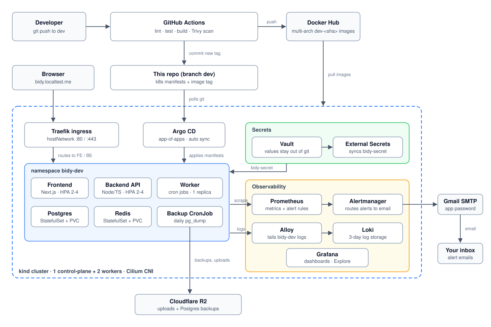

# Bidy on Kubernetes: GitOps on a local kind cluster

**Bidy** is an online auction platform: a Node/TypeScript API with a cron worker, a Next.js
frontend, Postgres, Redis and Cloudflare R2. This repo runs it on a 3-node **kind** cluster with a
complete CI/CD and GitOps pipeline, and is also a worked example of running a small production-style
platform locally.

**In short**
- **Delivery:** a push to `dev` runs GitHub Actions (lint, test, build, **Trivy** scan, push image). The pipeline commits the new image tag to git and **Argo CD** rolls it out. Git is the only source of truth.
- **Runtime:** frontend and backend autoscale (HPA 2-4), a single worker owns the cron jobs, Postgres and Redis keep data on PVCs, and a daily Postgres backup goes to R2 with a tested restore.
- **Security:** secrets live in **Vault** and are synced by External Secrets Operator, never stored in git. Default-deny NetworkPolicy, non-root read-only pods, and a CI vulnerability gate.
- **Observability:** Prometheus and Grafana (dashboard "Bidy Overview"), Loki with Alloy for logs, and Alertmanager emailing alerts through Gmail.

| | |
|---|---|
| CI | GitHub Actions, Trivy scan (fails on HIGH/CRITICAL), multi-arch push to Docker Hub |
| CD | Argo CD app-of-apps, automated sync with prune and self-heal |
| Cluster | kind (1 control-plane + 2 workers), Cilium CNI, Traefik ingress, metrics-server |
| Secrets | HashiCorp Vault + External Secrets Operator |
| Observability | kube-prometheus-stack, Loki, Alloy, Alertmanager |

## Architecture



A push to `dev` runs the pipeline for the changed app. After the image passes the Trivy gate, the
workflow edits the tag in `k8s/apps/bidy/overlays/dev/kustomization.yaml` and commits it back; Argo CD
runs the migration hook and rolls the Deployments.

## Repository layout

```
.github/workflows/   cicd-dev-be.yml, cicd-dev-fe.yml
bidy-be/  bidy-fe/   application code and Dockerfiles
k8s/cluster/         kind config, bootstrap.sh, vault-bootstrap.sh
k8s/platform/        Helm values: cilium, traefik, vault, external-secrets, monitoring, loki, alloy
k8s/apps/bidy/       Kustomize base + overlays/dev
k8s/argocd/          root.yaml + applications/ (one Argo CD Application per component)
k8s/docs/            runbooks (restore-postgres.md)
```

Adding a component = one file in `k8s/argocd/applications/` (the Application) plus optional values
in `k8s/platform/<name>/`. Change config in git, not with `helm upgrade`: self-heal reverts manual edits.

## Run it

Needs Docker (about 12 GB for the VM), `kind`, `kubectl`, `helm`, and an SSH key that can read this repo.

```bash
./k8s/cluster/bootstrap.sh
```

Creates the cluster, installs Cilium and Argo CD, applies the root app; Argo CD installs the rest
(first sync takes a few minutes for image pulls). `*.localtest.me` resolves to 127.0.0.1, no `/etc/hosts` edits.

| What | Where |
|---|---|
| App | http://bidy.localtest.me |
| Grafana | http://grafana.localtest.me (user `admin`) |

```bash
kubectl -n monitoring get secret monitoring-grafana -o jsonpath='{.data.admin-password}' | base64 -d; echo   # Grafana password
```

### Port-forwards

Each command blocks; run it in its own terminal, or start them all in the background.

```bash
kubectl -n argocd port-forward svc/argocd-server 8080:443               # https://localhost:8080
kubectl -n monitoring port-forward svc/monitoring-prometheus 9090       # http://localhost:9090
kubectl -n monitoring port-forward svc/monitoring-alertmanager 9093     # http://localhost:9093
kubectl -n monitoring port-forward svc/monitoring-grafana 3000:80       # http://localhost:3000
kubectl -n monitoring port-forward svc/loki 3100                        # API only, use Grafana > Explore > Loki
kubectl -n vault port-forward svc/vault 8200                            # http://localhost:8200

pkill -f "kubectl.*port-forward"                                        # stop all
```

## Secrets (Vault)

Vault's data lives on a PVC, so a rebuilt cluster starts empty. `bootstrap.sh` runs
`k8s/cluster/vault-bootstrap.sh`, which initialises and unseals Vault, recreates the policies and
Kubernetes auth roles, and loads secrets from files **outside the repo**:

| File | Loaded into | Used by |
|---|---|---|
| `~/.bidy/vault-init.json` | (unseal key + root token, written on first init) | the script |
| `~/.bidy/bidy-secret.json` | `secret/bidy/dev` | app (`bidy-secret`) |
| `~/.bidy/alertmanager-secret.json` `{"smtp_password": "..."}` | `secret/monitoring/alertmanager` | Alertmanager email |

Back these files up. Vault starts sealed after every pod restart: run `./k8s/cluster/vault-bootstrap.sh` again.

Rotate a secret (ESO syncs within a minute; pods read env vars only at start):
```bash
kubectl -n vault exec -i vault-0 -- env VAULT_TOKEN=<root-token> vault kv patch secret/bidy/dev JWT_SECRET=<new>
kubectl -n bidy-dev rollout restart deploy/bidy-backend deploy/bidy-worker
```
`POSTGRES_PASSWORD` is also stored inside Postgres: change it there (`ALTER USER`) too.

## Alerts and email

Rules live in `k8s/platform/monitoring/extras/bidy-rules.yaml` (backend down, crash loops, unready pods,
HPA at max, Postgres backup failed or missing). Alertmanager emails only alerts named `Bidy*` or
`Postgres*` through Gmail SMTP; the app password comes from Vault. Test it:

```bash
kubectl -n monitoring port-forward svc/monitoring-alertmanager 9093 &
curl -XPOST localhost:9093/api/v2/alerts -H 'Content-Type: application/json' \
  -d '[{"labels":{"alertname":"BidyTest","severity":"warning"},"annotations":{"summary":"test mail"}}]'
```

## Design notes

- **Traefik uses `hostNetwork`**: Cilium's `hostPort` did not forward kind's host ports. Hence one
  replica, `maxSurge: 0`, a static `ingressEndpoint`, and a `CiliumNetworkPolicy` for its traffic.
- **One cron owner**: cron jobs run in a single-replica `worker` Deployment; the API runs with `ENABLE_CRON=false`.
- **Migrations are an Argo hook** (Sync) that runs before each rollout; the seed is non-fatal.
- **HPA owns replicas**: not in git, Argo ignores `/spec/replicas`.
- **`NEXT_PUBLIC_*` are baked at build time**, so they come from CI build args.
- **Logs**: Alloy tails only `bidy-dev` pods through the Kubernetes API and pushes to Loki (3-day retention).
- **Backups**: daily `pg_dump` to R2, 7-day retention; restore is verified ([restore-postgres.md](k8s/docs/restore-postgres.md)).

## Known limitations

- Single Postgres and Redis (no HA); Redis is not backed up. Traefik has one replica.
- The backend rate limiter (300 requests / 15 min per IP) blocks load tests from one machine.
- `bidy-be/.env` is committed with real credentials: rotate them or use dummy values before going public.
- The backend does not expose `/metrics` yet, so there are no request or latency metrics.

## TODO

- **Chaos tests** (delete backend / Postgres / Redis / Traefik pod, drain a node, kill the worker) with a
  `curl` loop, results and a blameless postmortem in `k8s/docs/chaos-postmortem.md`.
- **Vault**: TLS, auto-unseal, Raft snapshots to R2, Reloader so pods restart on secret change.
- **Multiple environments**: `overlays/staging` and `overlays/prod`, one Argo Application each
  (or an `ApplicationSet`), promotion by tag/PR, separate secrets, database and R2 bucket.
- Backend `/metrics` (prom-client) with a ServiceMonitor; HPA load test with the rate limiter relaxed.
- Short ADRs (kind, hostNetwork, Vault with External Secrets).
