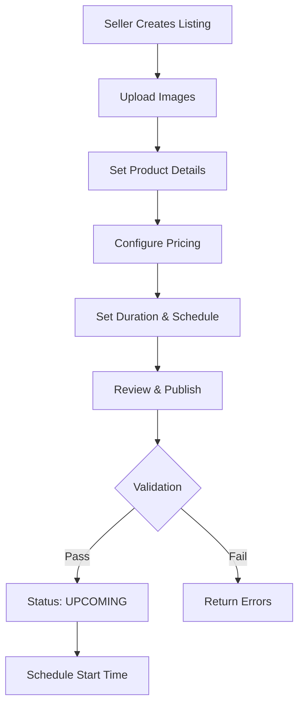
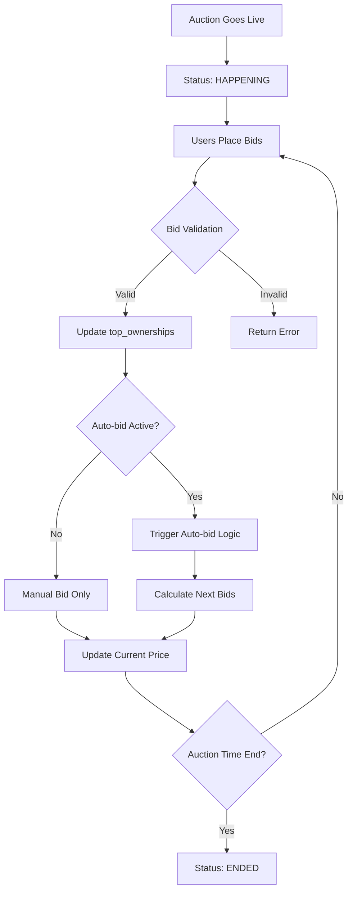
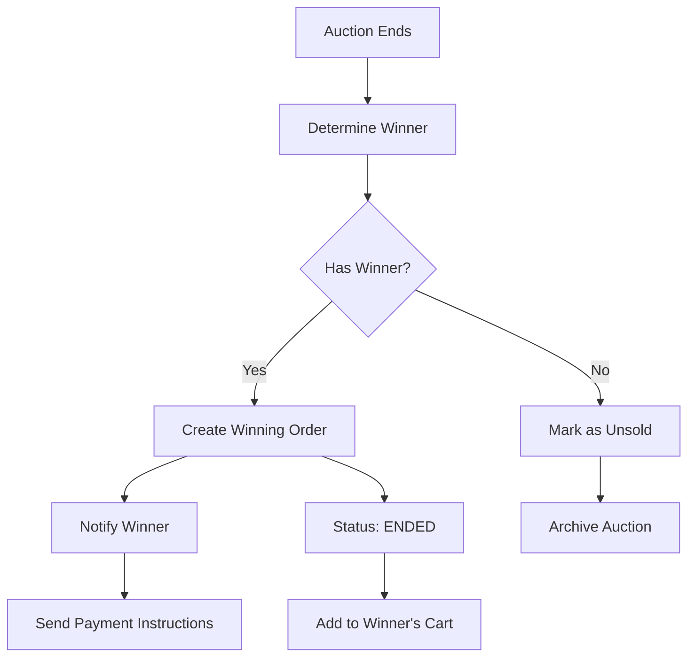
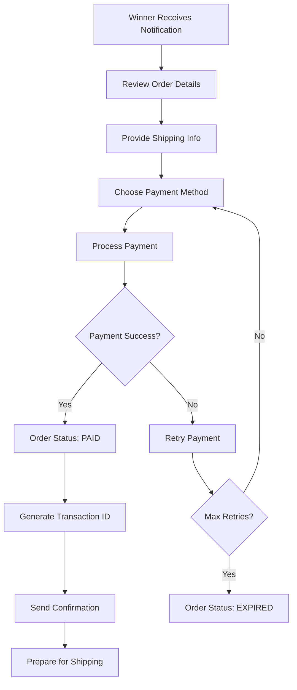

# Bidy Auction System - Complete Design Specification

## System Overview

The Bidy auction system is a comprehensive online bidding platform that handles the complete auction lifecycle from listing creation through purchase completion. This document provides detailed design specifications for all auction features.

## Current Implementation Analysis

### Database Models

#### Bid Model (Primary Auction Entity)
- **Core Fields**: name, owner, description, category, quantity
- **Timing**: startDate, endDate, bidHideTime, durationDays
- **Pricing**: price (starting), priceBuyNow (instant purchase)
- **Bidding**: top_ownerships (bid history), hasActiveAutoBid
- **Status**: status (upcoming, happening, ended)

#### Order Model (Purchase Management)
- **Core Fields**: user_id, bid_id, price, status
- **Payment**: isPayment, paidAt, transactionId
- **Status Flow**: pending → paid/cancelled/expired

#### Cart Model (Temporary Holdings)
- **Purpose**: Hold items before order creation
- **Fields**: user_id, bid_id, price, status

### Status Management
- **UPCOMING**: Auction scheduled but not started
- **HAPPENING**: Active bidding period 
- **ENDED**: Auction completed, awaiting payment
- **ORDER_STATUS**: pending, paid, cancelled, refunded, expired

## Complete Auction Lifecycle Design

### Phase 1: Auction Listing



#### Listing Creation Features
1. **Product Information**
   - Name, description, category selection
   - Multiple image upload with AWS S3 integration
   - Quantity specification

2. **Pricing Strategy**
   - Starting bid price
   - Optional "Buy Now" price for instant purchase
   - Reserve price (hidden minimum)

3. **Timing Control**
   - Start date/time scheduling
   - Duration in days
   - Bid hide time (blind bidding period)

4. **Validation Rules**
   - Image requirements (min 1, max configurable)
   - Price validation (starting < buyNow)
   - Category existence verification
   - User authentication & permissions

### Phase 2: Bidding & Competition



#### Bidding Mechanisms

1. **Manual Bidding**
   - Minimum increment validation
   - Real-time price updates
   - Bid history tracking in top_ownerships

2. **Auto-bidding System**
   - User sets maximum bid limit
   - Automatic incremental bidding
   - Configurable increment amounts
   - Smart proxy bidding logic

3. **Buy Now Option**
   - Instant purchase at fixed price
   - Bypasses bidding process
   - Immediately creates order

4. **Security Features**
   - Bid hiding during specified periods
   - Anti-sniping time extensions
   - Rate limiting on bid attempts

### Phase 3: Auction Completion & Winner Determination



#### Winner Determination Logic
1. **Highest Valid Bid**
   - Extract winner from top_ownerships[0]
   - Validate bid is above reserve (if set)
   - Check user account status

2. **Order Creation**
   - Auto-generate Order document
   - Link to winning bid and user
   - Set status to 'pending'
   - Calculate final price (bid + fees)

3. **Notification System**
   - Email winner notification
   - SMS alerts (if enabled)
   - In-app notifications
   - Seller notifications

### Phase 4: Purchase Preparation & Payment



#### Purchase Flow Features

1. **Order Management**
   - Order details review page
   - Shipping information collection
   - Payment method selection
   - Order status tracking

2. **Payment Integration**
   - Multiple payment gateways support
   - SMS payment confirmation parsing
   - Automatic transaction matching
   - Payment retry mechanisms

3. **Post-Purchase Processing**
   - Order confirmation emails
   - Transaction ID generation
   - Inventory updates
   - Shipping label generation

## API Design Specifications

### Auction Listing APIs

```typescript
// Create New Auction
POST /auction/listing
Content-Type: multipart/form-data
Body: {
  name: string;
  description: string;
  category: string;
  price: string;
  priceBuyNow?: string;
  quantity: number;
  durationDays: string;
  images: File[];
}

// Get Auction by Status
GET /auction/{status}
Response: {
  success: boolean;
  data: Bid[];
  pagination?: {
    page: number;
    limit: number;
    total: number;
  }
}

// Update Auction
PUT /auction/listing/{id}
Content-Type: multipart/form-data
Body: UpdateProductBody
```

### Bidding APIs

```typescript
// Place Manual Bid
POST /auction/listing/{id}/bid
Body: {
  amount: number;
  price?: number;
  isAuto?: boolean;
  limitBid?: number;
  incrementAmount?: number;
}

// Buy Now
POST /auction/listing/{id}/buy-now
Body: {} // Empty - immediate purchase

// Disable Auto-bid
DELETE /auction/listing/{id}/auto-bid
Response: DisableAutoBidResponse
```

### Order & Payment APIs

```typescript
// Create Order
POST /auction/order/create
Body: CreateOrderBody

// Check Order Status
GET /auction/order/{bid_id}/check
Response: {
  hasOrder: boolean;
  order?: Order;
  paymentStatus: string;
}

// Process Payment
POST /auction/payment
Body: {
  orderId: string;
  paymentMethod: string;
  amount: number;
}
```

## Status Flow Management

### Auction Status Transitions
```
UPCOMING → HAPPENING → ENDED
    ↓         ↓         ↓
Schedule   Active    Winner
Creation   Bidding   Determined
```

### Order Status Transitions
```
PENDING → PAID → DELIVERED
   ↓        ↓        ↓
Payment   Confirmed  Complete
Required  Processing  

PENDING → EXPIRED (timeout)
PENDING → CANCELLED (user/admin action)
PAID → REFUNDED (dispute/return)
```

## Advanced Features

### Auto-bidding Algorithm
```javascript
function processAutoBid(auction, newBid) {
  const autoBidders = auction.top_ownerships
    .filter(bid => bid.isAuto && bid.limitBid > newBid.amount);
  
  autoBidders.forEach(bidder => {
    const nextBid = Math.min(
      newBid.amount + bidder.incrementAmount,
      bidder.limitBid
    );
    
    if (nextBid > newBid.amount) {
      placeBid(auction._id, {
        user_id: bidder.user_id,
        amount: nextBid,
        isAuto: true
      });
    }
  });
}
```

### Real-time Updates
- **WebSocket Integration**: Live bid updates, auction status changes
- **Push Notifications**: Mobile app notifications for outbid alerts
- **Email Notifications**: Auction end, payment reminders, shipping updates

### Security Measures
1. **Input Validation**: Joi schemas for all API inputs
2. **Rate Limiting**: Express-rate-limit for bid endpoints
3. **Authentication**: JWT tokens for all protected routes
4. **Data Sanitization**: Prevent XSS and injection attacks
5. **Audit Logging**: Track all bid and order activities

## Performance Optimizations

### Database Indexing
```javascript
// Critical indexes for auction queries
bidSchema.index({ status: 1, endDate: 1 }); // Active auctions
bidSchema.index({ owner: 1, status: 1 });   // User's auctions
bidSchema.index({ category: 1 });           // Category filtering
bidSchema.index({ name: 'text' });          // Search functionality
```

### Caching Strategy
- **Redis Cache**: Active auction data, user sessions
- **CDN**: Static images, category data
- **Application Cache**: Categories, user profiles

### Cron Jobs
- **Auction Status Updates**: Transition upcoming → happening → ended
- **Payment Expiry**: Mark unpaid orders as expired
- **Auto-bid Processing**: Handle automated bidding logic
- **Notification Cleanup**: Remove old notifications

## Integration Points

### External Services
- **AWS S3**: Image storage and CDN
- **Payment Gateways**: VNPay, Momo, bank transfers
- **SMS Services**: Payment confirmations, notifications
- **Email Services**: Nodemailer for transactional emails

### Frontend Integration
- **React Query**: Data fetching and caching
- **WebSocket Client**: Real-time updates
- **Form Validation**: Zod schemas matching backend
- **Image Upload**: Direct to S3 with presigned URLs

## Monitoring & Analytics

### Key Metrics
- **Auction Success Rate**: % of auctions with successful sale
- **Average Bid Count**: Engagement metrics per auction
- **Payment Completion Rate**: % of winners who complete payment
- **User Activity**: Active bidders, new listings, repeat users

### Error Tracking
- **API Errors**: Failed requests, validation errors
- **Payment Failures**: Payment gateway issues, declined transactions
- **System Errors**: Database timeouts, service unavailability

This comprehensive design covers all aspects of the auction system lifecycle, providing a robust foundation for implementation and future enhancements.